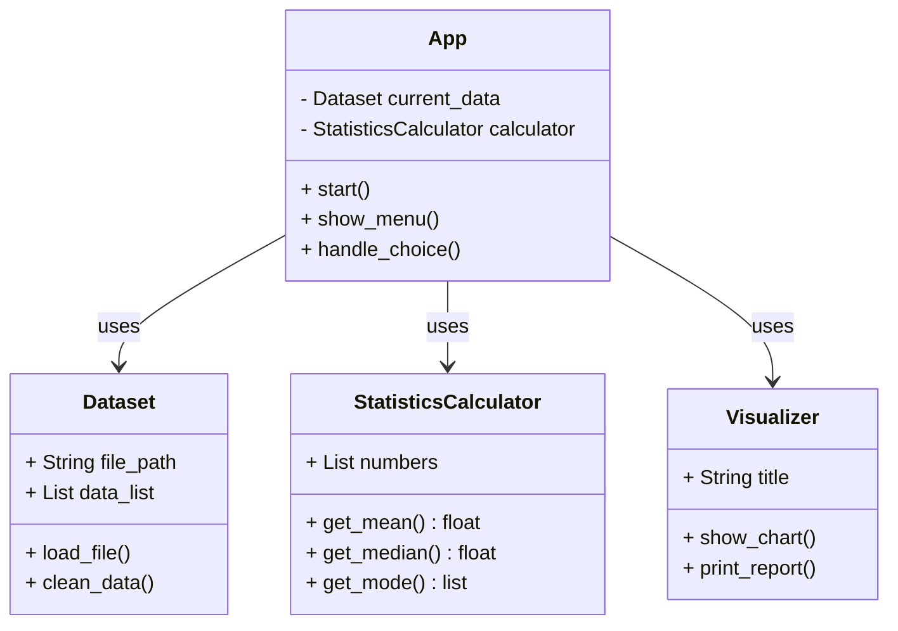

# CS3SY26_ProjectProposal by Aline Teresa Mendoza from CS Unit of PSHS

## Project Proposal Template:
### Project Title or Name of the Application	:  StudentStats: Student Survey & Math Helper
### Section			   	      : 9 - Cesium
### Group Members			    : TAN, Naya Nicolette C., LEGRAMA, Yuan Elizur V., LORILLA, Hurley Sebastien C.
### Date (Proposal Date)  : November 13, 2026
### Project Description:

High school students often conduct surveys to gather data on lifestyle habits such as daily study hours, sleep duration, and screen time. However, sorting through raw numbers and calculating statistics by hand is slow and prone to errors. StudentStats is a Python-based desktop application designed to solve this problem. It automatically imports survey data, cleans up missing entries, and computes key mathematical values like the mean, median, and mode. This application is needed to save students time, prevent math mistakes, and help them quickly see clear patterns in their school survey results.

### Target Users
Primary Users: Grade school and high school students who need to organize, analyze, and present survey findings for school performance tasks and research projects.

Secondary Users: Teachers who need a reliable, simple programming tool to demonstrate how statistical data works in real-world scenarios.

### System Features and OOP Design
1. **Dataset:** Manages opening and reading survey files.
   - Attributes: file_path(str), data_list(list)
   - Methods: load_file(), clean_data()
2. **StatisticsCalculator:** Performs all core math calculations.
   - Attributes: numbers(list)
   - Methods: get_mean(), get_median(), get_mode()
3. **Visualizer:** Formats and displays the results nicely.
   - Attributes: title(str)
   - Methods: start(), show_menu(), handle_choice()
4. **App:**  Controls the overall program and user menu.
   - Attributes: current_data(Dataset), calculator(StatisticsCalculator)
   - Methods: start(), show_menu(), handle_choice()
  
The _App_ class starts the program and instructs the _Dataset_ class to load the survey file. Once the data is cleaned, the numbers sent to the _StatisticsCalculator_ class to find the mean, median, mode. Finally, the _Visualizer_ class takes these results and prints a clear summary report to the user.

**Sample class Diagram from https://static.visual-paradigm.com/web/images/tutorials/class-diagram-tutorial/01-class-diagram-example.png:**

### Goals:
Describe the long term outcomes of your project followed by a couple of objectives to meet the goals stated in this paragraph

- Objective 1: Build a robust Dataset class that can safely open, read, and clean survey files without crashing.
- Objective 2: Write accurate math formulas inside the StatisticsCalculator class to instantly compute the mean, median, and mode.
- Objective 3: Design clear display methods in the Visualizer class to present the final statistical outputs and summaries in an easy-to-read format.

[Click here for Rubrics and Sample projects](https://docs.google.com/document/d/1xKd1CqK6DcNWS2_oJPBNtY5n3I3Hqiw8FY3W295Iqfk/edit?usp=sharing)
